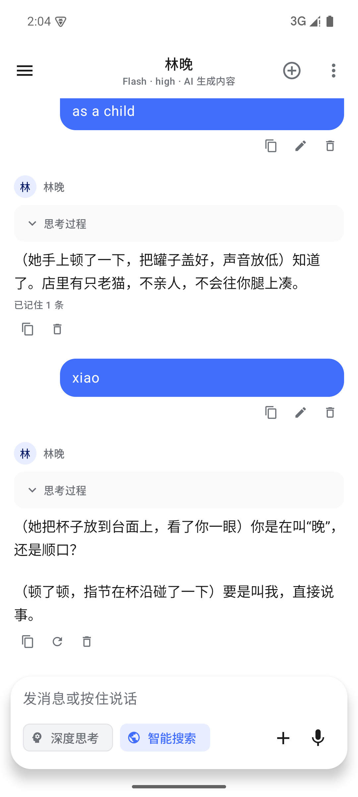
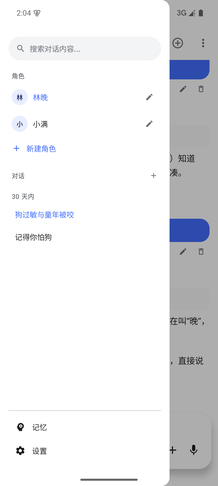
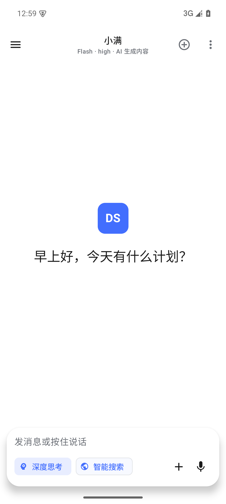
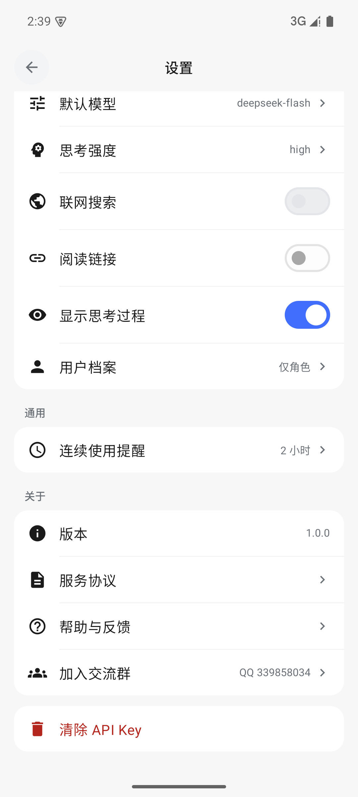
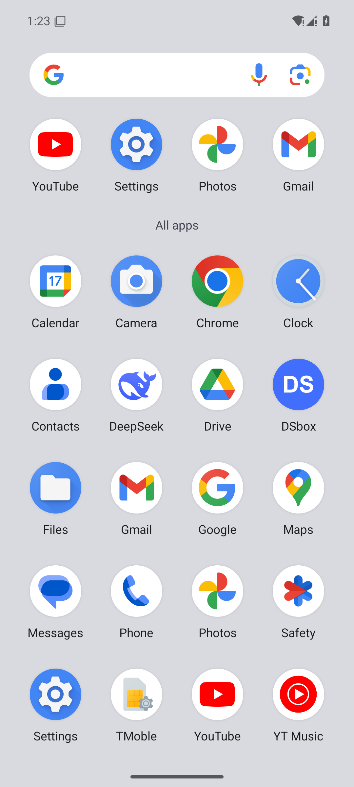

# DSbox

一个免费、开源的 Android 角色扮演 AI 客户端。自带 DeepSeek API Key，数据全部保存在本机，不经过任何第三方服务器。

界面按 DeepSeek 官方 Android 客户端的结构实现：侧边栏管理角色与会话、居中标题、胶囊输入栏、思考过程折叠、Markdown / LaTeX 渲染。

> 非官方项目，与 DeepSeek 官方无关联。应用名称与图标不使用 DeepSeek 商标。

## 功能

- 角色创建 / 编辑 / 删除，支持头像、聊天背景、开场白
- 角色设定可手动输入、粘贴，或导入 `txt` / `md` / `docx`（自动识别 UTF-8 / GBK）
- 所有角色与会话收进侧边栏，启动直接进入最近一次对话
- SSE 流式对话，思考过程可折叠，Markdown + LaTeX + 代码块
- 消息复制 / 编辑重发 / 重新生成 / 删除 / 停止生成
- 按角色隔离的长期记忆：`<mem>` 标签、去重、衰减评分、记忆管理页
- 上下文压缩：摘要 + 记忆整理，旧消息保留可浏览
- 图片理解（相册选择，压缩后发送）
- 文档解析（PDF / Word / PPT 经 Files API，txt / md / csv / xlsx 等按 user_data 上传）
- 官方联网搜索 / 阅读链接（仅 Flash）
- ASR 语音输入（16 kHz WAV，识别结果填入输入框）
- 官方分享链接导入：粘贴 `chat.deepseek.com/share/...`，导入标题、思考与消息
- 用量与费用估算
- 18+ 确认、AI 生成内容标识、连续使用提醒

朗读（TTS）因按字符计费，当前版本未开放入口。

## 截图

| 对话 | 侧边栏 | 新对话 |
| --- | --- | --- |
|  |  |  |

| 设置 | 桌面图标 |
| --- | --- |
|  |  |

## 交流群

使用问题、版本更新与反馈，欢迎加入 QQ 群：**339858034**

## 构建

需要 JDK 17 与 Android SDK 35。

```bash
export JAVA_HOME="C:/Program Files/Java/jdk-17"
./gradlew :app:assembleDebug
```

Debug APK 输出在 `app/build/outputs/apk/debug/app-debug.apk`。

Release 签名使用根目录的 `keystore.properties`（已 gitignore，不随仓库分发）：

```properties
storeFile=/absolute/path/to/release.jks
storePassword=***
keyAlias=***
keyPassword=***
```

然后执行：

```bash
./gradlew :app:assembleRelease
```

没有 `keystore.properties` 时 Release 构建会跳过签名配置，仍可通过 Android Studio 手动配置。

## 使用

1. 首次启动确认 18+。
2. 到 DeepSeek 开放平台申请 API Key，粘贴到应用中。Key 只存在本机 Android Keystore 加密存储。
3. 创建角色，开始对话。

所有对话、角色、记忆、附件都在本机。应用只直接请求用户配置的 DeepSeek 官方 API。

## 分享链接导入

设置 → 数据管理 → 从分享链接导入，粘贴公开分享链接。应用读取官方网页接口：

```
GET https://chat.deepseek.com/api/v0/share/content?share_id=<id>
```

导入标题、用户消息、助手回复与思考过程。分享里的图片和文件需要登录态才能下载，因此只写入文字占位。

该接口为网页端未公开接口，官方改动可能导致失效。

## 已知限制

- 备份与恢复尚未实现。
- 分享导入依赖未公开网页接口，且无法下载分享中的附件。
- 记忆“临时想起”（FTS5 召回）尚未接入。
- 切换模型 / 思考强度 / 联网开关会使前缀缓存失效一次，界面尚未提示。
- ASR 需要真机验证不同设备的麦克风兼容性。
- 动态背景、应用锁、用量 CSV 导出尚未实现。

## 免责声明

- 本项目仅提供客户端，不提供模型服务；API 费用由用户自己的 DeepSeek 账号承担。
- AI 生成内容不代表本项目观点，请自行判断并遵守所在地法律法规。
- 请勿使用侵犯他人肖像权、版权或违反 DeepSeek 平台协议的内容。
- DeepSeek 是其权利人的商标，本项目与官方无关联。

## License

[MIT](LICENSE)
